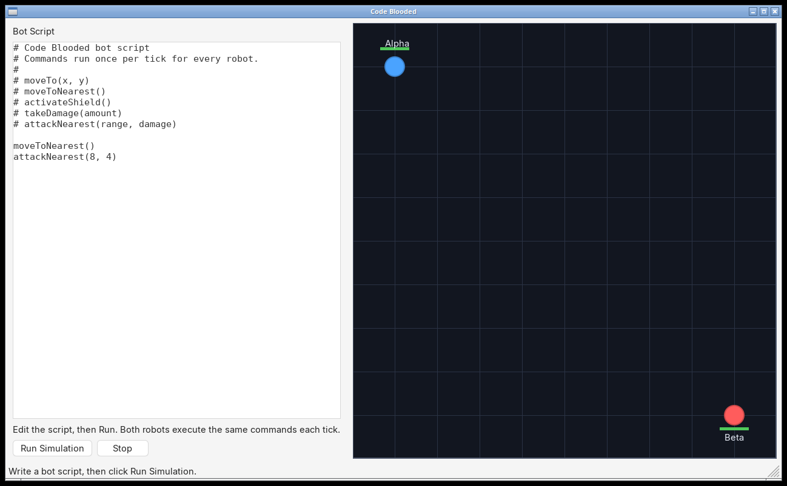
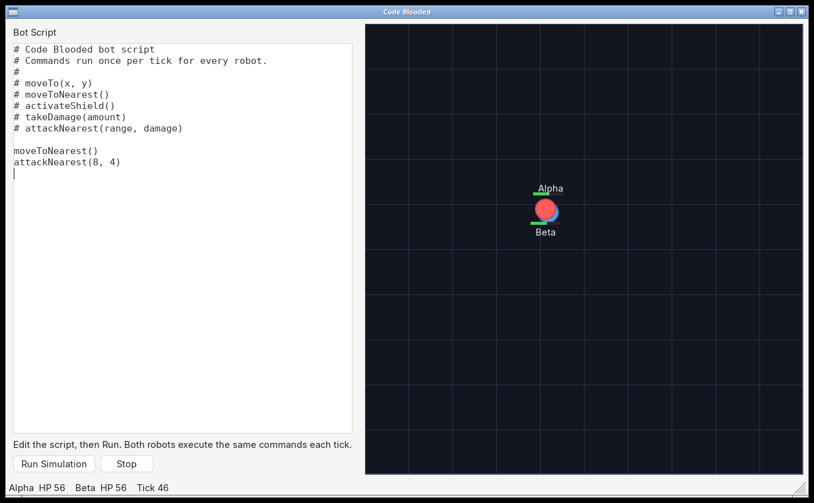

# Code Blooded

A small **wxWidgets** desktop game: you write a tiny bot script, then watch two robots (Alpha and Beta) fight it out in an arena.

The project is a C++ exercise in design, organization, and testing. Game logic (`Robot`, `ScriptEngine`, `Simulation`) has no UI dependency, so it can be unit tested without opening a window. The wxWidgets layer only edits scripts and draws the arena.

This is a native desktop app. There is no browser build.

[](https://github.com/NolenM93/wxWidgets_Game/actions/workflows/ci.yml)

## Download for Windows

**[Download for Windows](https://github.com/NolenM93/wxWidgets_Game/releases/latest)** (latest GitHub Release)

Get `CodeBlooded-windows-x64.zip`, unzip it, and double-click `CodeBlooded.exe`. The zip includes the wxWidgets DLLs and the MSVC runtime, so it should run on a clean 64-bit Windows 10 or 11 PC. No installer.

The first release is published after this CI workflow runs on a `v*` tag (see [Producing a release](#producing-a-release) below). Until then the latest-release link will 404.

## Screenshots

Editor on the left, arena on the right. Alpha (blue) starts in the top-left, Beta (red) in the bottom-right.



After **Run Simulation**, both robots execute the script every tick, close in, and attack when they are in range.



## How to play

1. Launch `CodeBlooded.exe` (Windows) or the `CodeBlooded` binary you built (Linux).
2. The left panel is a bot script. A duel script is loaded by default.
3. Click **Run Simulation**. Both robots run the same commands once per tick (50 ms).
4. Watch health bars and the status bar (`Alpha HP …  Beta HP …  Tick …`).
5. Click **Stop** to pause. Click **Run Simulation** again to reset and replay.

### Script commands

Blank lines and comments (`#` or `//`) are ignored. Whitespace inside a line is ignored, so `moveTo(10, 20)` and `moveTo(10,20)` are the same.

| Command | Effect |
| --- | --- |
| `moveTo(x, y)` | Step 1.5 units toward that point (arena is 100 by 100). |
| `moveToNearest()` | Step toward the nearest living opponent. |
| `activateShield()` | Further damage to this robot is halved. |
| `takeDamage(amount)` | Hurt this robot (useful for tests and experiments). |
| `attackNearest(range, damage)` | If the nearest opponent is within `range`, deal `damage`. |

Sample scripts live in [`examples/`](examples/).

## Build instructions

### Windows (Visual Studio + vcpkg)

CI builds with CMake and vcpkg. The original Visual Studio solution is still the supported IDE entry point.

1. Install [Visual Studio 2022](https://visualstudio.microsoft.com/) with the **Desktop development with C++** workload.
2. Install [vcpkg](https://vcpkg.io/) and set `VCPKG_ROOT` to that clone.
3. Open `CodeBlooded.sln`. The repo-root [`vcpkg.json`](vcpkg.json) is a manifest; Visual Studio will restore **wxWidgets**.
4. Build **Release | x64**.

Or from a Developer PowerShell prompt (this is what GitHub Actions runs):

```powershell
cmake -B build -G "Visual Studio 17 2022" -A x64 `
  -DCMAKE_TOOLCHAIN_FILE="$env:VCPKG_ROOT/scripts/buildsystems/vcpkg.cmake"
cmake --build build --config Release
ctest --test-dir build -C Release --output-on-failure
```

Pack a zip like the GitHub Release asset:

```powershell
./scripts/package-windows.ps1
```

That writes `dist/CodeBlooded-windows-x64.zip`.

### Linux

Needs a C++17 compiler, CMake 3.20+, Ninja, and wxWidgets 3.2 GTK 3.

```bash
sudo apt-get install -y build-essential cmake ninja-build libwxgtk3.2-dev
cmake --preset linux
cmake --build --preset linux
ctest --test-dir build --output-on-failure
./build/bin/CodeBlooded
```

On Debian/Ubuntu 22.04 the wx package name may be `libwxgtk3.0-gtk3-dev` instead.

## Architecture and design

```
CodeBlooded.sln                 Visual Studio solution (kept working)
CMakeLists.txt                  Cross-platform build used by CI and Linux
vcpkg.json                      wxWidgets via vcpkg manifest mode
CodeBlooded/                    Application sources
  Vec2.h                        2D point / distance
  Robot.h/.cpp                  Health, shield, movement, arena clamp
  ScriptEngine.h/.cpp           Line-oriented bot language
  Simulation.h/.cpp             Reset + tick loop (no wxWidgets)
  App / MainFrame               wxApp, layout, Run / Stop
  EditorPanel                   Script editor
  ArenaPanel                    Timer, paint, status text
tests/test_game_logic.cpp       Unit tests for the logic above
examples/                       Sample .bot scripts
archive/Code_Blooded-early-skeleton/
                                First design sketch (not the playable game)
```

**Why two folders used to exist.** `CodeBlooded/` is the real wxWidgets game (robots, scripts, a window that actually paints). `Code_Blooded/` was an earlier sketch from the `Main_Frame` branch: empty `ArenaPanel`, a typo (`ArenaPaneel`), no `Robot` / `ScriptEngine`, and a `main()` that never started `wxApp`. That tree did not produce a successful build. Those sources were moved to `archive/Code_Blooded-early-skeleton/` so the work is not deleted, while interviewers get a single project to open.

**Layering.** `Simulation` owns robots and the script engine. `ArenaPanel` only starts a `wxTimer` and draws. Unit tests construct a `Simulation` and never link wxWidgets.

**UI.** `MainFrame` uses a horizontal sizer: editor + Run/Stop on the left, arena on the right. The original `EVT_MENU` binding on a `wxButton` would not fire; it is now `EVT_BUTTON`.

## Testing

There were no automated tests in the original repo. CI runs `codeblooded_tests` on Linux and Windows.

```bash
ctest --test-dir build --output-on-failure          # Linux
ctest --test-dir build -C Release --output-on-failure  # Windows
```

The suite covers:

- `Vec2` distance
- Movement step size and “already there” behavior
- Damage, shield halving, health floor, `isAlive`
- Arena clamping
- Script parsing (comments, whitespace, bad lines that must not throw)
- `moveToNearest` / `attackNearest`, including skipping self and dead robots
- A full duel `Simulation` that eventually deals damage

## Producing a release

GitHub Actions (`.github/workflows/ci.yml`) builds on pull requests and on `main`. It **publishes** `CodeBlooded-windows-x64.zip` only on:

- a push of a tag matching `v*` (for example `v1.0.0`), or
- **Actions → CI → Run workflow**, with the tag input set (default `v1.0.0`)

After merging this work to `main`, create the first downloadable build with:

```bash
git checkout main
git pull
git tag v1.0.0
git push origin v1.0.0
```

The workflow creates (or updates) that GitHub Release, attaches `CodeBlooded-windows-x64.zip`, and marks it as **latest**, which is what the [Download for Windows](https://github.com/NolenM93/wxWidgets_Game/releases/latest) link uses.

Alternatively, open the **CI** workflow in the Actions tab, choose **Run workflow** on `main`, leave the tag as `v1.0.0`, and run it. That path also creates the tag if it does not exist yet.
